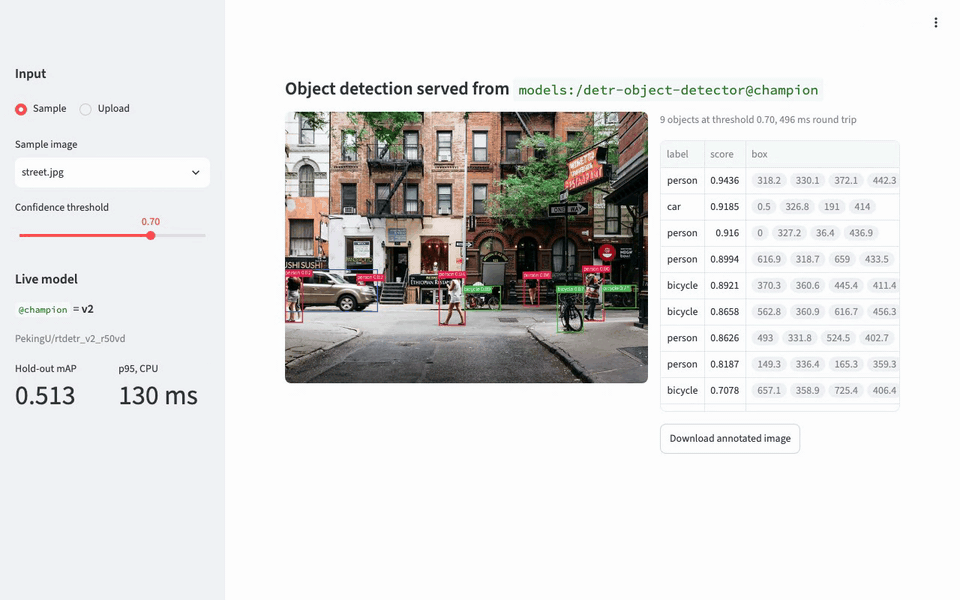
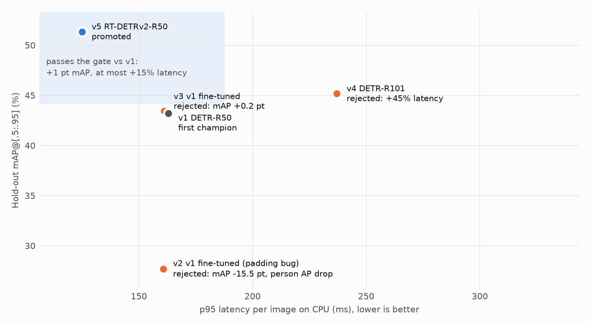
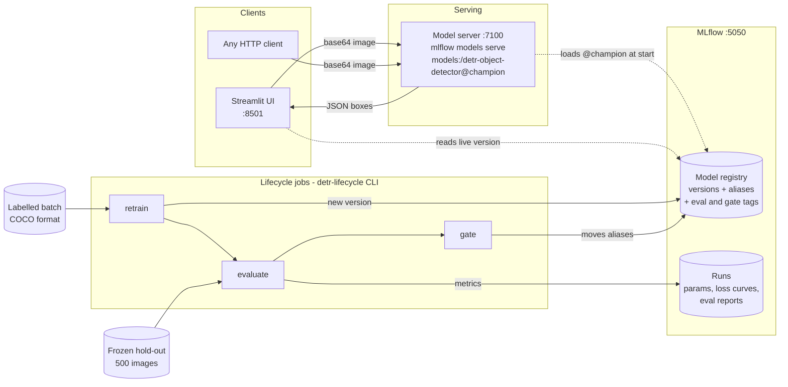
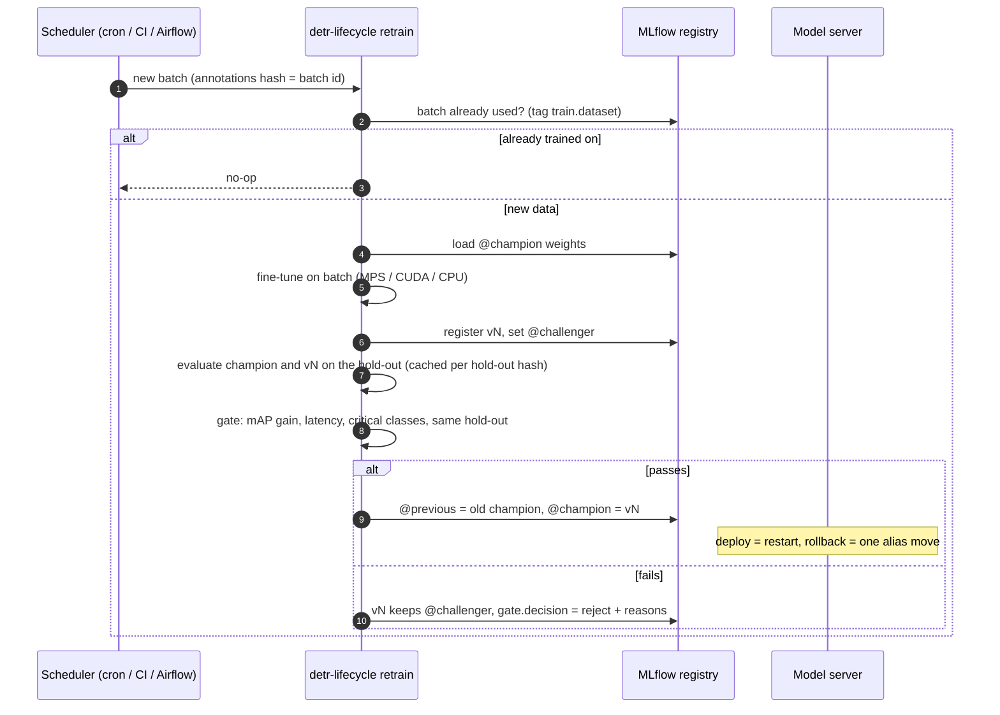

# DETR object detection with a model lifecycle

[](https://github.com/Maherstad/DETR-ObjectDetect-WebApp-MLFlow/actions/workflows/ci.yml)

[](LICENSE)

An object-detection API (DETR family, COCO's 80 classes) served from an MLflow model registry.
The detector is off the shelf. The point of the repo is the lifecycle around it: **a new model,
whether retrained on fresh labels or a different architecture, only goes live if it beats the
current one on a frozen hold-out set, without getting slower or worse on the classes that
matter.** Every decision and its reasons are stored in the registry.

<div align="center">

</div>

## Results

Four candidates went through the same gate against the starting model. Every number below was
measured here, none is quoted from a paper: 500 COCO val2017 images (seed 0) that no checkpoint
trained on, one image at a time on CPU, as served (Apple M4 Pro, 10 torch threads).

| Version | Candidate | mAP | mAP@.5 | `person` AP | p95 latency | Gate |
|---|---|---:|---:|---:|---:|---|
| v1 | DETR-R50, pretrained (starting champion) | 0.432 | 0.633 | 0.531 | 163 ms | - |
| v2 | v1 fine-tuned on a new 1,000-image batch | 0.277 | 0.528 | 0.322 | 161 ms | **Rejected**: −15.5 pt mAP, `person` −21 pt. A data bug, see below |
| v3 | v1 fine-tuned again, bug fixed | 0.434 | 0.634 | 0.532 | 161 ms | **Rejected**: +0.2 pt, below the 1 pt bar |
| v4 | DETR-R101, pretrained | 0.452 | 0.669 | 0.549 | 237 ms | **Rejected**: +2.0 pt, but 45 % slower |
| v5 | RT-DETRv2-R50, pretrained | **0.513** | **0.686** | **0.618** | **125 ms** | **Promoted**: +8.1 pt *and* 23 % faster |

<picture>
  <source media="(prefers-color-scheme: dark)" srcset="docs/results/operating-points-dark.png">
  
</picture>

What this shows:

- **The gate caught a bug the training loss hid.** v2's loss went down the whole run, yet it was
  15 points worse. mAP@.75 fell almost twice as much as mAP@.5, which pointed at box coordinates:
  batch padding was re-normalising the training targets. Fixed and pinned by a test
  ([ADR 0004](docs/decisions/0004-retrain-on-new-data-not-on-a-timer.md)).
- **"Slightly better" is not better.** Fine-tuning a model that already knows COCO on 1,000 more
  COCO images gained 0.2 points. A paired bootstrap puts that gain between −0.1 and +0.5, so
  it may be nothing at all. The gate's bar is 1 point, so v3 stays registered but never serves.
- **Accuracy alone would have picked the wrong model once.** DETR-R101 is 2 points better and
  45 % slower. On a CPU-hosted API that means about 45 % more replicas for the same traffic.
  RT-DETRv2 is better on both axes, so it went live, and v1 stays one alias move away as
  `@previous`.

## How it works



What happens when a labelled batch lands:



## Decisions

The choices that shape the system, each with the options I rejected. Full write-ups in
[`docs/decisions/`](docs/decisions).

| Decision | Chosen | Instead of | Why |
|---|---|---|---|
| [0001](docs/decisions/0001-serve-a-pyfunc-from-the-registry.md) How to serve | Custom MLflow PyFunc, `mlflow models serve` | FastAPI service; TorchServe / Triton | The registry URI is the deploy target, so "what is live" can't drift. Triton pays off above ~50 req/s or with a GPU, not at this load. |
| [0002](docs/decisions/0002-aliases-not-stages.md) How versions go live | Aliases `@champion` / `@challenger` / `@previous` | `Production` stage (deprecated) | Registering no longer means deploying. Rollback is one alias move. |
| [0003](docs/decisions/0003-promotion-gate.md) What counts as better | Paired comparison on a frozen hold-out: mAP gain ≥ 1 pt (about 6× the measured paired noise), ≤ 15 % slower, no drop on `person` | A fixed bar ("mAP ≥ 0.85") | A fixed bar says nothing about the model already serving. An average can hide a class getting worse. |
| [0004](docs/decisions/0004-retrain-on-new-data-not-on-a-timer.md) When to retrain | When a new labelled batch arrives; idempotent per batch | A 24 h timer | A timer retrains on unchanged data. New labels are what make a better model possible. |
| [0005](docs/decisions/0005-json-detections-not-images.md) What the API returns | JSON labels, scores, boxes; threshold per request | The image with boxes drawn on it | Downstream systems count, alert and audit; they can't do that with a JPEG. |

## What would change if…

The current design fits one model, CPU hosting and a few requests per second. These are the
scenarios that would change it, and how.

| If… | I would… | Because |
|---|---|---|
| Traffic grows 100× (hundreds of req/s) | Export the champion to ONNX, serve with Triton and dynamic batching; the deploy job reads `@champion` and builds the Triton model repo | One PyFunc process does ~8 images/s on a 10-thread CPU. Batching on a GPU is far cheaper per image at that load. |
| It has to run on a camera or edge box in real time | Gate a small RT-DETR or YOLO variant against an absolute latency budget (`--latency-budget-ms`) on the target device, and quantise to INT8 | The gate already takes a latency budget. The question moves from "most accurate" to "most accurate that fits 30 fps on this hardware". |
| A missed person is a safety incident | Make `person` recall at the served threshold a hard gate check, and pick that threshold from a precision-recall curve on the hold-out | mAP averages over thresholds. Safety cares about recall at the threshold actually served. |
| The business needs classes COCO doesn't have (helmets, forklifts) | Fine-tune a new head on a labelled set with its own hold-out, as a new registered model rather than a new version | A gate only means something when champion and challenger answer the same question on the same data. The gate already refuses mismatched hold-outs. |
| Labels are the bottleneck | Log low-confidence production images, send those to labelling first (active learning), and feed the result in as the next batch | `retrain` doesn't care where a batch came from. This changes what's in it, not how it's used. |
| Each customer needs their own model | One registered model per tenant, same aliases and gate, shared serving fleet that loads by tenant | Promotion and rollback stay per customer, so one tenant's retrain can't break another. |
| Audit or regulation applies | Keep eval report and gate summary per version (already done) and add a manual approval step before the alias move | The registry already records why each version did or didn't ship. Approval is the missing human sign-off. |
| Promotion must not need a restart | A small controller that watches the alias and does a rolling restart, or Triton's model-control API | Today a registry write never changes production by itself. That is intended, but it is a manual step. |

## Run it

```bash
docker compose up --build
```

| Service | URL |
|---|---|
| UI | http://localhost:8501 |
| MLflow (runs, registry) | http://localhost:5050 |
| Model API | http://localhost:7100/invocations |

On first start a one-shot `bootstrap` job downloads `facebook/detr-resnet-50` (~170 MB) and
registers it as `@champion`. The image is CPU-only.
Ports are configurable with `MLFLOW_PORT`, `MODEL_PORT`, `UI_PORT`.

### Put a challenger through the gate

```bash
uv sync --all-extras                               # local env (Python 3.11–3.13)
export MLFLOW_TRACKING_URI=http://127.0.0.1:5050

uv run detr-lifecycle data --out data/holdout --n 500 --seed 0     # frozen hold-out
uv run detr-lifecycle register PekingU/rtdetr_v2_r50vd              # new version
uv run detr-lifecycle gate 2                                        # evaluate, decide, promote?
uv run detr-lifecycle status
docker compose restart model-server                                 # serve the new champion
uv run detr-lifecycle rollback                                      # if it goes wrong
```

### Retrain on a new labelled batch

```bash
uv run detr-lifecycle data --out data/batches/2026-10-batch-01 --n 1000 --seed 1 --exclude data/holdout
uv run detr-lifecycle retrain --batch data/batches/2026-10-batch-01   # recipe flags: --help
```

Any COCO-format folder (`annotations.json` + `images/`) works as a batch. `--exclude` keeps
hold-out images out of training.

### Develop

```bash
uv run pytest            # ~7 s, no downloads: tiny random DETR + a real MLflow registry
uv run ruff check . && uv run mypy src
```

## API

```bash
# macOS base64 shown; on Linux use: base64 -w0 assets/street.jpg
curl -s localhost:7100/invocations -H 'Content-Type: application/json' -d @- <<EOF
{"dataframe_records": [{"image": "$(base64 -i assets/street.jpg)"}], "params": {"threshold": 0.7}}
EOF
```

```json
{"predictions": [{"width": 750, "height": 562, "detections": [
  {"label": "person", "label_id": 0, "score": 0.9436, "box": [318.2, 330.1, 372.1, 442.3]},
  {"label": "car", "label_id": 2, "score": 0.9185, "box": [0.5, 326.8, 191.0, 414.0]}
]}]}
```

Boxes are `[x_min, y_min, x_max, y_max]` in pixels. Use `label`, not `label_id`: the id is the
checkpoint's own class index (RT-DETR counts from 0, DETR from 1) and changes when the champion
changes architecture.

Python client: [`examples/client.py`](examples/client.py).

## Repository layout

```
src/detr_lifecycle/
  model.py      Detector (the only code that runs the network) + DetrPyFunc served by MLflow
  registry.py   register versions with weights inside the artifact; alias moves, rollback
  data.py       reproducible COCO subsets, hold-out exclusion, training dataset
  evaluate.py   COCO mAP (faster-coco-eval) + per-image CPU latency, stored on the version
  gate.py       promotion rules as a pure function, unit-tested on their own
  train.py      DETR fine-tuning loop
  pipeline.py   gate and retrain jobs
  cli.py        detr-lifecycle command
app/            Streamlit UI, a client of the model server like any other
scripts/        recipe sweep, hold-out noise bootstrap, results chart, demo GIF recording
docs/decisions/ architecture decision records
```

## Limitations

- **COCO stands in for "new data".** The retrain batch is 1,000 val2017 images: new to the
  model, but from the distribution it was trained on. A batch from a new site or camera would
  carry domain shift, which is where fine-tuning usually earns its keep.
- **Latency is from one laptop.** The numbers compare versions with each other, not with a
  server. In production the gate should run on the serving hardware class.
- **No live traffic in the decision.** There is no shadow or canary stage, so a model can pass
  the hold-out and still behave differently on production images.
- **SQLite and local artifacts.** Fine for one user. A team needs Postgres and object storage
  behind the tracking server, and auth in front of it and the model server.
- **Closed vocabulary.** The models know COCO's 80 classes and nothing else. On
  `assets/safari.jpg` (impalas), DETR-R50 reports three cows at 0.93–0.99 confidence;
  RT-DETRv2 reports nothing. Neither is told it is out of its depth, and the hold-out set,
  being COCO, can't catch it.
- **No drift monitoring** on what the model sees in production.

## History

First built in February 2024 as a DETR PyFunc with a Streamlit page. Rebuilt in October 2026
around the lifecycle: real retraining, the gate, aliases, a JSON API, a working one-command
start, tests and CI. See the [changelog](CHANGELOG.md).

COCO annotations © COCO Consortium, [CC BY 4.0](https://cocodataset.org/#termsofuse). Images
are downloaded from their source URLs and not stored in this repository.
